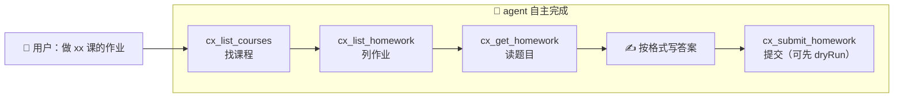

<div align="center">

# 📚 cx-mcp

**xxt（cx）作业协议 MCP Server**

_接入后，agent 一条龙完成：选课 → 列作业 → 读题 → 写答案 → 提交_

[](https://nodejs.org)
[](https://modelcontextprotocol.io)
[](./LICENSE)

</div>

---

## 📦 依赖

| 依赖 | 要求 |
|---|---|
| [Node.js](https://nodejs.org) | **≥ 18**（需内置 fetch，建议 20+） |
| 安装 | 克隆/下载本目录后执行一次 `npm install` |

```bash
npm install
```

## 🔧 配置

在 mcpServers 中添加（`/path/to/cx-mcp` 替换为你本机的克隆路径）：

```json
{
  "mcpServers": {
    "cx-mcp": {
      "command": "node",
      "args": ["/path/to/cx-mcp/server.mjs"]
    }
  }
}
```

## 🚀 用法

用户只需告诉 agent 要做哪个（哪些）课程的作业：



## 📝 answer 值格式

| 题型 | 值 | 示例 |
|---|---|---|
| 单选 | 单个大写字母 | `"A"` |
| 多选 | 字母升序连写 | `"ABD"` |
| 判断 | 固定词 | `"Right"` / `"Wrong"` |
| 填空 | JSON 数组串（每空一项） | `'["答案1","答案2"]'` |
| 简答/富文本 | HTML 字符串 | `"<p>…</p>"` |

## 🧰 工具一览

| 工具 | 说明 |
|---|---|
| `cx_set_cookies` | 交付 Cookie（整段请求头字符串），当场验证并保存 |
| `cx_check_login` | 验证登录态；无效时返回 `NOT_LOGGED_IN` 引导 |
| `cx_list_courses` | 全部课程（courseId / classId / cpi / 名称 / 教师） |
| `cx_list_homework` | 某课全部作业（workId / answerId / enc / 标题 / 状态） |
| `cx_get_homework` | 题目详情 + 作答格式说明 + 提交令牌 |
| `cx_submit_homework` | 提交作业（`pyFlag=3` 真实交卷；`dryRun: true` 只生成请求体） |

## 📄 License

[MIT](./LICENSE)
